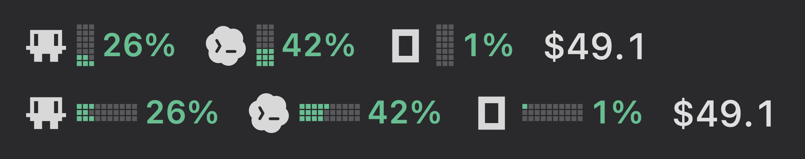
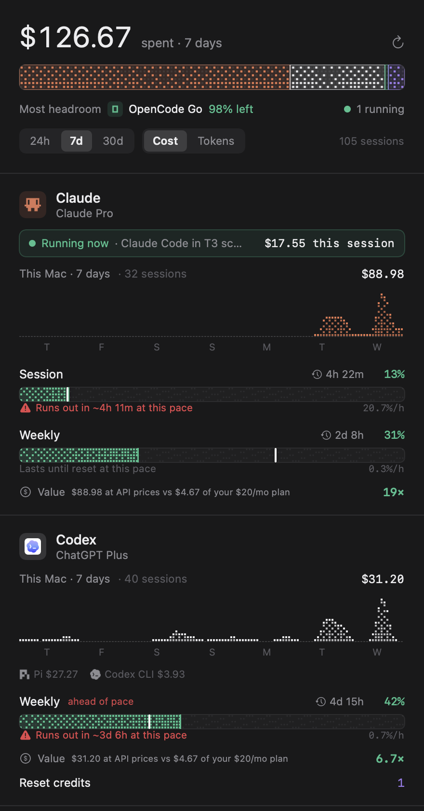

# Tally

A small macOS menu bar app that shows what your AI coding subscriptions are doing: how much of each plan's limit you've used, when it resets, how fast you're burning through it, and what your usage would have cost at API prices. Drawn in an ordered-dither style.





## What it tracks

| Subscription | Limits (live) | Spend & tokens (from local logs) |
| --- | --- | --- |
| **Claude** (Pro / Max) | Session (5h), weekly, per-model weekly | Claude Code |
| **Codex** (ChatGPT Plus / Pro) | Session, weekly, reset credits | Codex CLI, Pi (`openai-codex`) |
| **OpenCode Go** | Rolling 5h, weekly, monthly | Pi (`opencode-go`), OpenCode |
| **OpenCode Zen** | — (free models) | OpenCode |
| **OpenAI** | — | Pi (`openai`) |

Cards are grouped by **subscription**, not by app, so if one tool (say, Pi) spends on several plans, each plan gets its share.

## Features

- **Menu bar meters**: one dithered meter per plan (columns or bars), coloured by usage, plus today's / 7-day / 30-day spend. Pick which limit each meter shows, which plans appear, and what the label next to each meter says: % used, that plan's cost, or its tokens (today / 7d / 30d), always or only at high usage.
- **Limits with pace**: every limit shows % used, a reset countdown, and a tick for where an even pace would put you.
- **Runway forecast**: "Runs out in ~2d 22h at this pace", from your recent burn rate (falls back to the average since the window opened).
- **Alerts**: notifications at 80% / 95%, when a limit resets, and when you're on pace to run out before the reset.
- **Value per plan**: API-price usage vs. what the plan costs for the same stretch (e.g. *16× value*). Prices are editable in Settings.
- **Running now**: a live badge while a session is active, with that session's spend.
- **Spend by project**: groups usage by the folder your agent worked in (worktrees fold into their repo).
- **Spend by model**: a dithered treemap with a labelled legend.
- **Per-plan charts** with hover readouts, 24h / 7d / 30d, cost or tokens.
- **Global shortcut** ⌥⌘U to open the panel.
- Light / dark / system appearance, launch at login, drag-to-reorder plans.

## How it gets the data

Everything is read locally. Nothing is sent anywhere except each provider's own usage endpoint, using the login that provider's CLI already saved.

- **Spend & tokens:** session logs in `~/.claude/projects`, `~/.codex/sessions`, `~/.pi/agent/sessions`, and OpenCode's `~/.local/share/opencode/opencode.db`. Costs are estimated with the [LiteLLM price table](https://github.com/BerriAI/litellm) (uses T3 Code's cached copy if present, otherwise downloads it once).
- **Claude limits:** the Claude Code OAuth token from the Keychain (`Claude Code-credentials`) → `api.anthropic.com/api/oauth/usage`.
- **Codex limits:** `~/.codex/auth.json` → `chatgpt.com/backend-api/wham/usage`, falling back to the rate-limit data in Codex's own logs.
- **OpenCode Go limits:** the Go API key from Pi or OpenCode's `auth.json` (or `OPENCODE_GO_API_KEY`) → `opencode.ai/zen/go/v1/usage`.

Tokens are never refreshed or written back, so your CLIs' sessions are left alone. These usage endpoints are undocumented and may change.

## Build

Requires macOS 14+ and Xcode / Swift 5.10+.

```sh
./build-app.sh        # builds, installs to ~/Applications/Tally.app, and launches it
```

Handy for development:

```sh
swift build -c release
.build/release/Tally --dump                 # print totals and limits in the terminal
.build/release/Tally --snapshot out.png     # render the panel to a PNG
```

## Credits

- Brand logos from [LobeHub Icons](https://github.com/lobehub/lobe-icons) (MIT). The Claude pixel mascot is redrawn from Claude Code. All logos and names are trademarks of their owners; this project isn't affiliated with any of them.
- Pricing data from [LiteLLM](https://github.com/BerriAI/litellm).

## License

MIT
